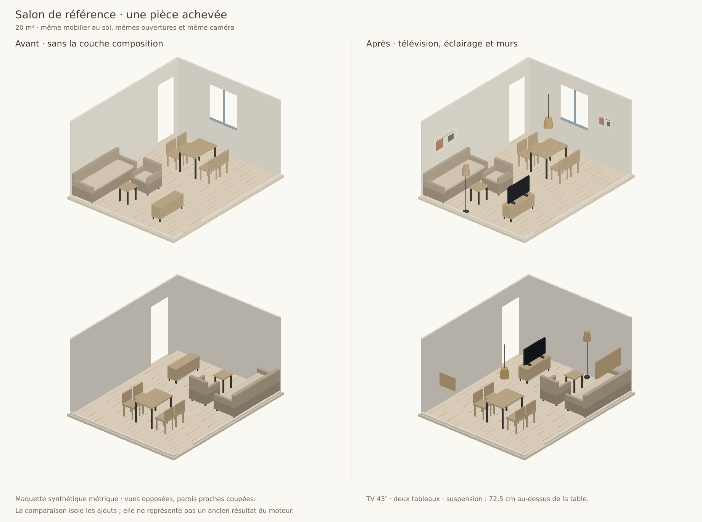

# Télévision, éclairage et murs — 11 octobre 2026

Le salon reçoit désormais un écran distinct du meuble TV, des luminaires et une composition murale. Les sept programmes décrivent leur point focal. Les ajouts suivent le budget et le vrai contour ; un élément impossible à poser reste déclaré dans les détails de la pièce. Une pièce déjà enregistrée doit être réaménagée pour recevoir ces ajouts.

## Modèle et placement

| Champ | Contrat |
|---|---|
| `kind: wall_item` | Objet fixé à un segment réel ; aucune emprise de passage au sol |
| `mur`, `wall_offset` | ID du segment et distance depuis son premier sommet, en mètres |
| `y`, `height` | Hauteur du centre de l’objet mural ou suspendu ; `y` conserve la compatibilité de l’éditeur |
| `attach_to` | Mur, plafond ou ID du meuble support |
| `surface_item` | TV ou petit objet sur un meuble ; la hauteur réelle vient du support |
| `ceiling_item` | Corps suspendu à une hauteur contrôlée ; câble relié au plafond |

La couche murale passe après les zones et le placement micro. Elle recherche un segment libre, sa position et sa hauteur, sans déplacer le mobilier au sol. Les coordonnées d’ouverture sur les murs d’entrée/gauche et les murs obliques gardent leur sens propre. Les volumes verticaux refusent fenêtres, portes, plafonds dépassés, masquage par un rangement haut et superpositions. Une TV posée doit tenir sur son support ; les objets d’un même plateau sont contrôlés entre eux.

Le tableau principal se centre au-dessus du canapé, du lit ou du bureau ; sa largeur cible est 50–70 % du meuble. Le centre par défaut est à 1,475 m, augmenté si nécessaire pour garder un espace au-dessus du dossier. La valeur contradictoire « 90–100 cm au-dessus du dossier » n’est pas appliquée. La suspension est centrée sur la table avec son bas à 72,5 cm au-dessus du plateau. Une suspension basse sans table support n’est pas conservée ; ailleurs, son bas reste à au moins 2,10 m. Le rendu 3D utilise la hauteur enregistrée et reconstruit le luminaire lorsqu’elle change.

La TV et la suspension suivent leur support lors des déplacements et rotations manuels dans RealRoom et Maison Corleone. Sauvegarde et rechargement conservent les hauteurs, les attaches et les usages ; le serveur recalcule les attaches murales et conserve les données produit de son catalogue.

## Compositions

| Pièce | Point focal | Éclairage prévu | Muraux |
|---|---|---|---|
| Salon | TV par défaut ; tableau principal si « sans TV » | Salon, repas et lecture selon les zones retenues | Deux tableaux ; étagère facultative à partir de 32 m² ; cible 2–4 |
| Chambre | Lit | Une ou deux lampes de chevet ; lecture/travail si présents | Tableau principal et second à partir de 13 m² ; cible 2–4 |
| Salle à manger | Table | Suspension obligatoire | Tableau secondaire, cible 1–2 |
| Bureau | Bureau | Lampe de bureau ; lecture facultative | Tableau et étagère facultative, cible 2–4 |
| Entrée | Miroir | Applique ou lampadaire facultatif | Miroir au-dessus de la console, cible 1–2 |
| Salle de bain | Vasque | Installation électrique à vérifier ; aucune qualification d’un luminaire inventée | Miroir, cible 1–2 |
| Terrasse | Salon extérieur | Aucun luminaire intérieur transféré automatiquement | Pas de décoration murale imposée |

Le brief « TV murale » conserve ce mode de pose. Le choix par défaut préfère une TV posée et une diagonale connue compatible avec la distance du patron salon. Le micro pénalise une distance hors de 1,5–3 diagonales, un écran tourné à l’opposé du canapé et une fenêtre devant l’écran. Un écran conservé, un plafond budgétaire ou une petite pièce peuvent encore empêcher la cible : aucune diagonale commerciale inconnue n’est inventée.

## Poids de composition

| Règle | Points |
|---|---:|
| Focal visible depuis une entrée connue, par test de rayon sur les volumes | +6 |
| TV face au canapé | +5 |
| Fenêtre devant l’écran | −8 |
| Focal dans le dégagement d’une porte | −100 |
| Source lumineuse dans une zone salon/repas/sommeil/travail/lecture | +4 par zone |
| Suspension centrée / décentrée sur la table | +5 / −10 |
| Fenêtre latérale au bureau | +3 |
| Tableau principal présent / absent derrière le canapé | +4 / −4 |
| Largeur du tableau proportionnée au canapé | +4 |
| Miroir au-dessus de la console | +3 |
| Objet mural sur une ouverture | −100 |
| Objet mural masqué par un meuble haut | −15 |
| Superposition de volumes | −50 |
| Mur utilisable sans aucun élément proche | −2 |

Ces points servent au classement mural et au diagnostic `finition`. Les contraintes du solveur restent prioritaires : les conflits verticaux coûtent 100 000 dans le micro. L’orientation de l’écran utilise une pénalité de 480, le contre-jour 400 et la distance hors cible 160 par mètre d’écart. Ces échelles internes ne sont pas une note de beauté. Aucun poids d’accès n’a été modifié à partir de la critique vision.

## Catalogue

Les 341 références commerciales comprennent 52 luminaires dans les familles lampe/lampadaire/applique/suspension/lustre. Elles ne comprennent ni TV, ni tableau, ni étagère murale identifiée.

La demande précédente de compléter les objets génériques autorise dix modèles de projet supplémentaires : TV posées 32/43/55 pouces, TV murales 43/55 pouces, quatre tailles de tableaux abstraits originaux et une étagère murale de 80 cm. Le catalogue compte maintenant 54 objets génériques. Ils sont identifiés comme tels, avec une provision indicative comptée dans le budget, aucune offre commerciale ni lien d’achat. Ils ne sont pas présentés comme des produits vendus par Maison Corleone. Le miroir générique et les tableaux ont aussi été corrigés pour que leur surface reste visible devant leur cadre.

## Vérification

- 176 tests unitaires, sans échec ni test ignoré ; les tests antérieurs restent dans cette suite.
- Build Next réussi.
- 13 scénarios API sur le port isolé 3237, fournisseur remplacé localement : compte, démo IA, sauvegarde/rechargement des hauteurs et attaches, données produit forgées, vignettes, caméra, crédit unique et nettoyage.
- Salon synthétique de référence : 14 objets, TV 43 pouces face au canapé, un lampadaire, deux tableaux, suspension centrée ; géométrie, hauteur, circulation et plan de zones admissibles. Score de composition −10 sans la couche, +30 avec.
- Banc de 13 salons et 10 chambres : 23/23 sans conflit géométrique ou de hauteur ; 18/23 audits de zones admissibles. Dix programmes sont à la fois complets pour les usages obligatoires et admissibles. Un rangement seul peut être géométriquement valide sans constituer une chambre complète.
- Les essais sur le DXF client restent locaux. Leurs données et résultats sont exclus des artefacts versionnés. Les JSON, logs de banc et rendus publiés proviennent exclusivement des fixtures synthétiques.

Les [résultats](composition-hauteur/resultats.json) gardent les manques et durées. Les temps dépendent de la machine. Les logs texte accompagnent le banc et les tests ; les appels API utilisent un double de fournisseur, ils ne prouvent pas un nouvel appel d’aménagement IA réel en ligne.

## Comparaison visuelle



Le [comparatif](composition-hauteur/comparaison.png) utilise les mêmes meubles au sol, les mêmes ouvertures et deux caméras opposées. « Avant » retire la couche TV/lumières/murs du résultat final : il isole les ajouts, ce n’est pas le rendu d’un ancien commit. Les maillages génériques sont ceux du projet ; les autres meubles sont des fixtures aux dimensions du banc. Projection 3D avec tampon de profondeur logiciel ; les parois proches sont coupées pour lire la pièce. Ce n’est pas une photo générée ni une capture WebGL de l’interface.

Deux appels bornés à `openrouter/router/vision`, avec `google/gemini-2.5-flash`, ont préféré « après » dans les deux ordres A/B. Les images sont synthétiques et ont été incorporées aux requêtes avec `store_payload: false`, sans téléversement de fichier client sur un CDN. Les [sorties de comparaison](composition-hauteur/vision.json) conservent les réserves sur la variété des tableaux, sans identifiants de compte/requête ni données de facturation. Le modèle attribue aussi une meilleure accessibilité à une disposition identique : cela confirme que son avis ne certifie pas la géométrie. La boucle n’a pas été poursuivie jusqu’à une prétendue victoire universelle.

## Reproduction et repli

```bash
npm ci
npm test
node scripts/valider-details.mjs
node scripts/illustrer-details.mjs
npm run build
PORT=3237 node tests/api.mjs
```

Pour le cas client local, définir `DXF_REGRESSION=/chemin/prive/plan.dxf` avant le banc ou les essais API. Le banc écrit ce résultat uniquement dans le dossier temporaire système, sous `realroom-details-dxf-local.json`, et ne l’ajoute jamais aux rapports versionnés. Ne pas versionner le DXF ou ce fichier privé.

La couche est activée par défaut. `REALROOM_COMPOSITION_DETAILS=0` côté serveur ou `NEXT_PUBLIC_REALROOM_COMPOSITION_DETAILS=0` au build désactive les ajouts automatiques. Sur la preview, `localStorage.setItem('rr-composition-details','0')`, puis recharger ; supprimer cette clé pour réactiver. Le client transmet le choix dans la démo et les projets authentifiés. Ce repli ne retire pas les objets déjà enregistrés et garde les contrôles géométriques.

[RealRoom](https://realroom-git-codex-realroom-plan-optimisation-2026-10-09-kpw4.vercel.app/fr/demo) · [Maison Corleone](https://realroom-git-codex-realroom-plan-optimisation-2026-10-09-kpw4.vercel.app/fr/maison-corleone/demo) · [PR nº 2](https://github.com/CelKevProductions/realroom/pull/2). Même branche de preview, aucun merge, promotion ou migration de production.

Le navigateur cloud redirige la preview vers « Login – Vercel ». Sans session authentifiée, la validation interactive de l’interface est bloquée ; elle n’est pas revendiquée. Les tests locaux ne certifient pas les installations électriques, une performance GPU mobile ou l’optimum global de toutes les pièces.
