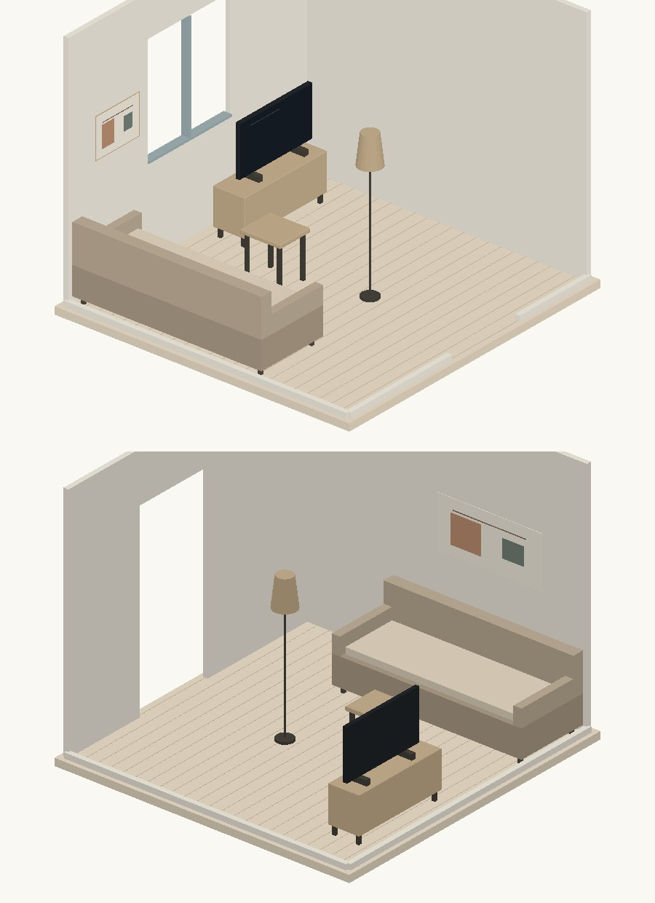
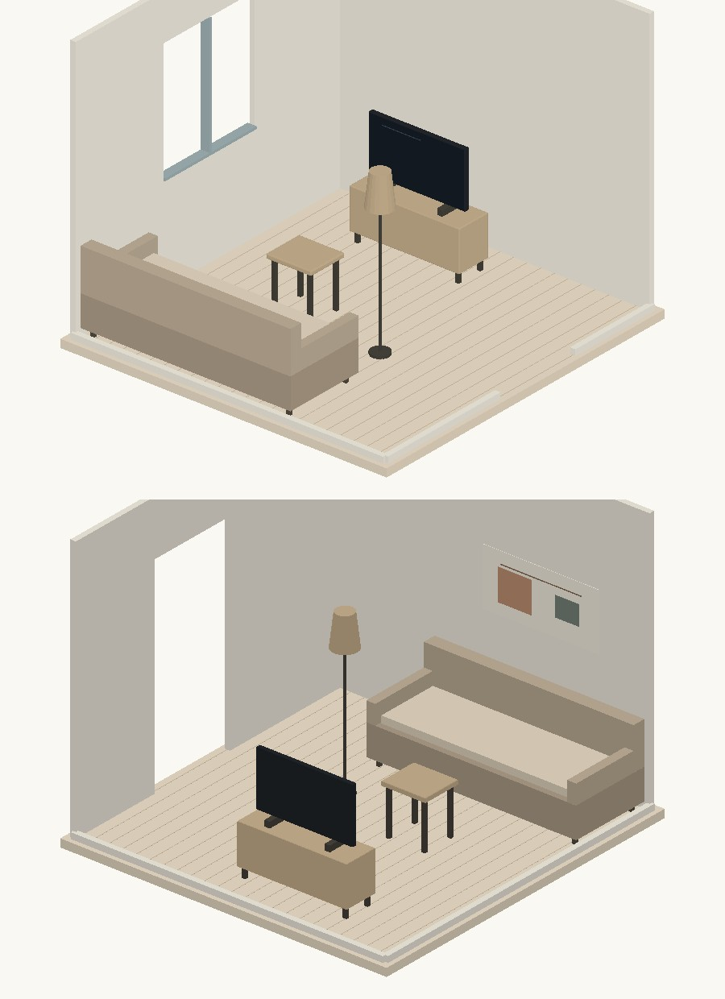
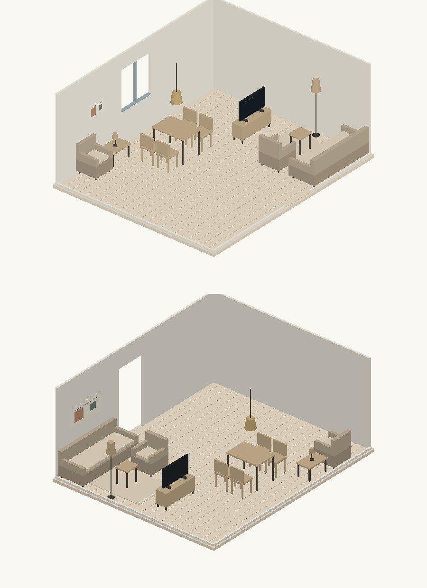
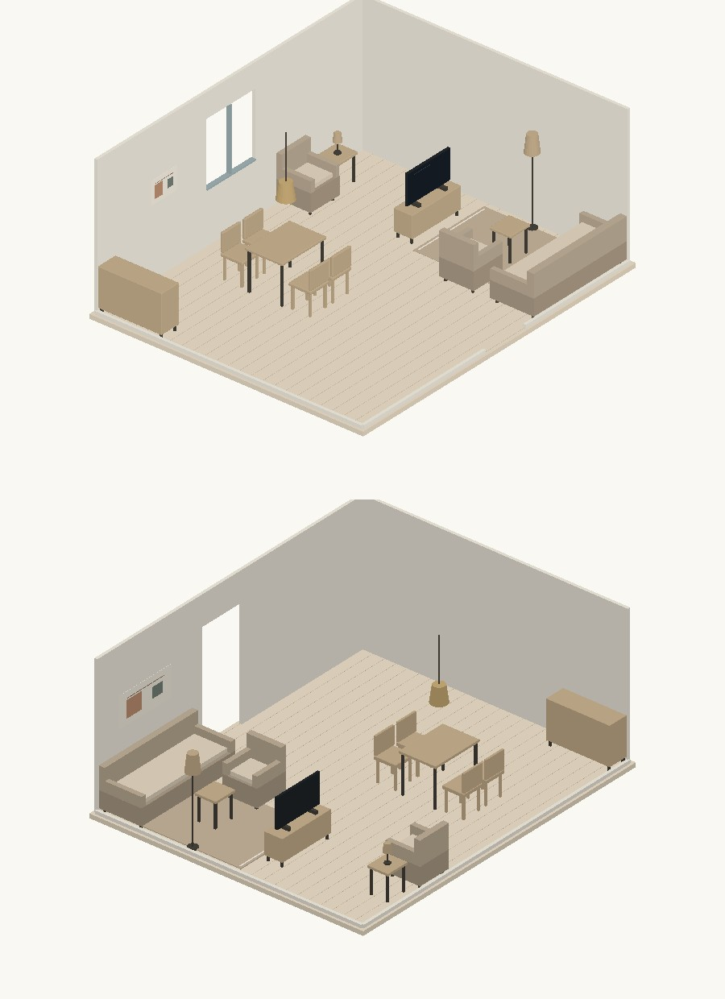
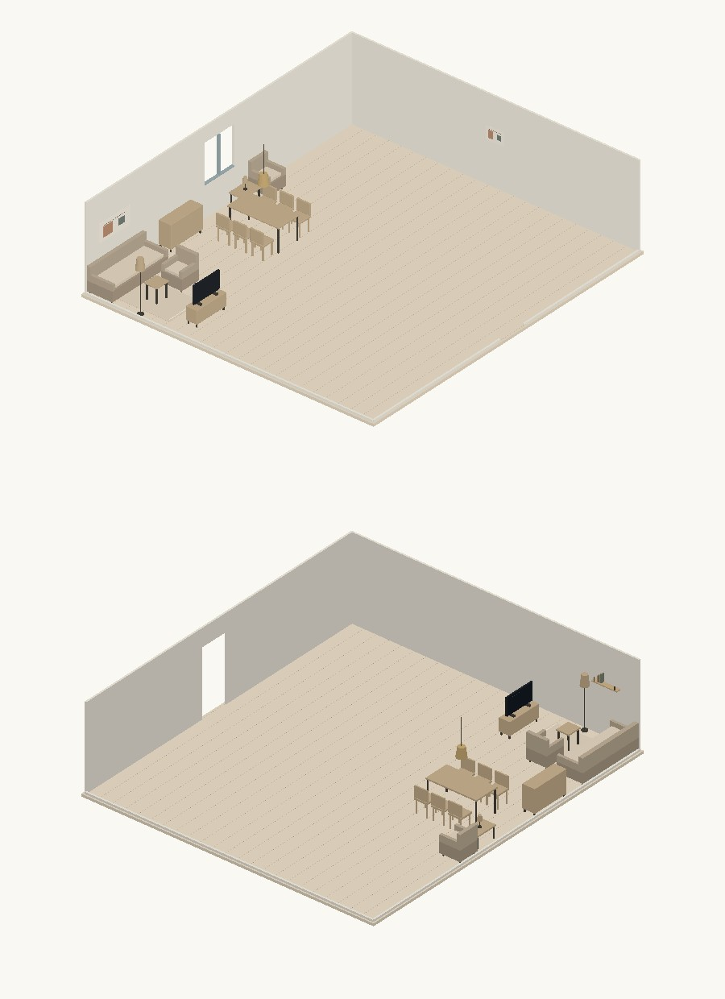
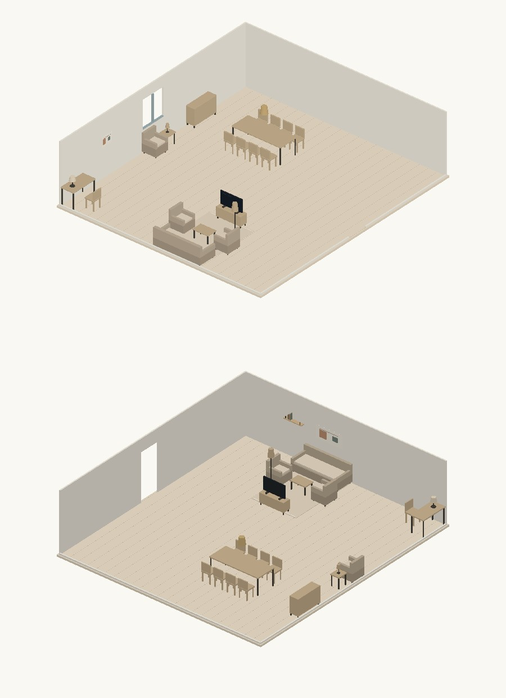

# Composition à l’échelle et multi-zonage — 11 octobre 2026

Les deux consignes de composition ont été lues intégralement et confrontées au code. Les corrections sont sur la branche `codex/realroom-plan-optimisation-2026-10-09`, PR nº 2, en prévisualisation. Les tests fonctionnels passent ; les deux comparaisons finales à 30 m² et celles à 90 m² préfèrent la version corrigée, dans les deux ordres d’affichage. Ce résultat porte sur les références documentées, pas sur toute pièce possible.

## Diagnostic et échelle

Le moteur lisait déjà l’aire du vrai polygone, et les sept programmes comportaient des paliers. La référence immédiate, commit `65fd5c83a309b4219031295f34ac4f7d2e89bdb0`, avait aussi une télévision et des détails muraux : elle produit 18 objets à 30 m² et 22 à 90 m² dans le présent banc. Les 6–7 objets décrits dans la consigne correspondent donc à un état antérieur ; ce chiffre n’est pas présenté comme le résultat du commit comparé.

Les défauts encore présents étaient le plafond de 24 emplacements de budget, l’absence de palier open-space, la recherche de groupes concentrée dans quelques positions, et l’abandon de compléments pourtant logeables. Un siège de bureau était aussi traité comme un obstacle à son propre poste, et les petits objets pouvaient perdre leur support après un déplacement du meuble porteur.

L’hypothèse B, séjour de l’ordre de 90 m², est retenue comme **hypothèse de travail d’après la mise à jour de la consigne**. Aucune mesure terrain indépendante ne permet de la certifier ni de départager définitivement A et B. Le code distingue unités métriques et cotes confirmées. Il calcule l’aire du contour, signale les portes hors 0,60–1,40 m et les hauteurs hors 2,10–4,50 m, et demande une cote de contrôle lorsque les dimensions restent estimées. Il ne redimensionne aucune pièce à partir d’une porte supposée standard. La démo conserve la provenance métrique sans transformer une provenance absente en mesure confirmée.

## Programme et arbitrage

Avant le réaménagement, le dialogue partagé demande les idées, les espaces à créer, le budget et le nombre de convives. Le texte reconnaît notamment « table à manger » et « je reçois ». Les cases explicites et les exclusions priment sur les valeurs par défaut, y compris une sélection vide. Le choix propose maintenant 2, 4, 6, 8 ou 10 places.

| Usage | Paliers retenus et compléments |
|---|---|
| Salon | <14 m² : canapé, table basse, meuble TV, lumière ; télévision et un tableau. 14–20 : un fauteuil et un second tableau. >20 : tapis, seconde activité complète et deux fauteuils de salon si aucun coin lecture. Dès 28 : repas, lecture et buffet par défaut lorsqu’ils ne sont pas exclus ; dès 32 : étagère murale. >40 : trois activités, circulation de 1,10 m. >75 : quatre activités, deux fauteuils de salon, huit places à table, bureau avec siège et lampe. |
| Chambre | <10 m² : un chevet et sa lampe ; ≥10 : deux. ≥13 : banc, rangement bas facultatif et second tableau. >16 : lecture complète, sauf priorité au bureau demandé. Lit et armoire constituent la base. |
| Salle à manger | <12 m² : quatre places ; 12–18 : six ; >18 : huit. Suspension centrée et tableau. Buffet dès 12, vaisselier facultatif et second tableau au-delà de 18. |
| Bureau | Bureau, siège, lampe, tableau et étagère murale. >9 : rangement et fauteuil de lecture avec lumière ; >14 : table d’appoint supplémentaire. |
| Salle de bain | Baignoire murale sous 10 m², îlot à partir de 10, vasque et miroir ; sèche-serviettes facultatif. Rangement facultatif dès 10. Plomberie et aptitude électrique restent à vérifier. |
| Entrée | Console, miroir et éclairage d’accueil. >5,5 : banc, portemanteau et tapis facultatifs ; >10 : rangement facultatif. |
| Terrasse | Salon extérieur ; >15 : repas quatre places ; >25 : six places et deux transats facultatifs. Aucun luminaire intérieur ou décor mural imposé. |

Ce sont des hypothèses éditoriales, documentées dans `DECISIONS.md`, et des inventaires cibles : un catalogue, un budget ou un accès impossible laisse un manque explicite. Le buffet du séjour à partir de 28 m² répond à l’absence de rangement et aux murs libres relevés pendant la comparaison. Aucun espace décoché n’est réactivé pour atteindre une quantité.

Références d’emprise des ensembles : salon 16 m², salon open-space 20, repas 16, lecture 8, travail 10. Les candidats dépassant 1,5 fois la référence sont écartés. Les chemins passent entre les emprises des ensembles. À plus de 20 m², la séparation minimale entre ensembles est de 0,80 m ; elle passe à 1,10 m en open-space. La largeur des chemins macro est 0,90 m, puis 1,10 m au-delà de 40 m² ; les contrôles micro des accès restent actifs. Cette séparation empêche notamment le fauteuil de lecture de se confondre avec le groupe repas.

La recherche conserve jusqu’à 144 candidats par groupe en séjour intermédiaire, 104 en grand open-space, puis au plus 64 états. Elle préserve les variantes localement cohérentes et différentes orientations/positions du dernier groupe, pour ne pas perdre un rangement accessible. Trois reprises au plus essaient les alternatives compactes et le retrait des facultatifs. Le budget admet 40 emplacements de salon avec 4 096 états bornés ; son repli conserve la limite précédente de 24. Les produits gardés restent fixes et le plafond budgétaire reste contraignant.

## Focal, luminaires et hauteur

Les sept usages déclarent leur point focal. Le salon reçoit un écran physique distinct du meuble TV, sauf exclusion explicite : un grand tableau prend alors le rôle focal. Les poids restent +6 pour la visibilité depuis l’entrée, +5 pour TV face au canapé, −8 pour une fenêtre en face et −100 dans un battant. Chaque zone éclairée reçoit +4 ; une suspension centrée +5, décentrée −10. Le bureau reçoit +3 pour le jour latéral ; la variante de lampe opposée à la fenêtre bénéficie d’une préférence macro de +2, sans supposer la main dominante.

Les objets muraux conservent `wall_item`, le segment, `wall_offset`, la hauteur et l’attache. Le centre du tableau est à 1,475 m, avec un relèvement si nécessaire pour garder 20 cm au-dessus du dossier. L’indication contradictoire de 90–100 cm au-dessus du dossier n’est pas retenue. La largeur cible est maintenant exactement de 1/2 à 2/3 du canapé. Le bas de la suspension est à 72,5 cm au-dessus du plateau. La télévision posée et les lampes suivent leur porteur pendant la résolution.

Poids muraux : mur principal occupé +4, vide −4 ; tableau centré/proportionné +4 ; miroir sur console +3 ; ouverture −100 ; masquage −15 ; collision verticale −50 ; mur mort −2. La cible 2–4 éléments reste adaptée aux murs utilisables ; la petite référence de 10 m² reçoit un seul tableau pour rester sobre. Aucun détail n’est placé sur une ouverture pour remplir cette cible.

Le catalogue partagé contient 341 produits commerciaux et 54 objets génériques de projet déjà autorisés. Les produits commerciaux comprennent 1 lampadaire, 10 appliques, 32 suspensions et 9 lustres, mais aucun écran, tableau, étagère murale ou lampe de table identifié. Les génériques sont marqués, avec provision indicative et aucun lien d’achat. Aucune nouvelle référence commerciale ni dimension marchande n’est inventée dans cette correction.

## Densité et limites du score

| Règle | Poids |
|---|---:|
| Salon >20 m² : cible `ceil(surface / 5)` éléments utiles | −5 par élément manquant |
| Une seule activité au-delà de 20 m² | −20 |
| Moins de trois activités en open-space >40 m² | −30 |
| Passage open-space inférieur à 1 m ou liaison invalide | −15 |
| Ensemble dépassant 1,5 fois sa référence | −10 |
| Mur libre de plus de 1,20 m sans meuble ou élément mural proche | −2 |
| Activité sans focal, lumière ou attrait naturel | −10 |

Télévision, tableaux, miroirs, étagères murales, tapis et plantes ne gonflent pas le comptage des éléments utiles. Une grille de 8×8 cellules du vrai polygone détecte aussi les activités concentrées : distance limite `min(2,5 m, sqrt(surface)/3)`, pénalité au-delà de 15 % de cellules éloignées. Ce seuil ne garantit pas une bonne esthétique. L’emprise indicative additionne des rectangles et ne constitue pas une union exacte des surfaces occupées.

Un diagnostic incomplet reste visible dans RealRoom et Maison Corleone. Un déplacement manuel ou une correction de dimensions invalide l’ancien diagnostic, au lieu d’afficher une densité périmée.

## Séquence et régressions

Même brief « Salon chaleureux », même catalogue synthétique complété par les génériques identifiés, même budget de 15 000. Les quantités incluent les détails en hauteur ; la colonne « utiles » suit la règle ci-dessus.

| Surface | Avant, objets | Après, slots / objets | Utiles | Activités placées | Passage macro | Obligatoires manquants | Conflits sol / hauteur |
|---|---:|---:|---:|---:|---:|---:|---:|
| 10 m² | 7 | 6 / 6 | 4 | 1 | 0,90 m | 0 | 0 / 0 |
| 18 m² | 8 | 8 / 8 | 5 | 1 | 0,90 m | 0 | 0 / 0 |
| 30 m² | 18 | 19 / 19 | 15 | 3 | 0,90 m | 0 | 0 / 0 |
| 90 m² | 22 | 28 / 28 | 23 | 4 | 1,10 m | 0 | 0 / 0 |

Les quatre audits de zones sont valides, les quatre focaux sont présents et aucun slot facultatif de ces références n’est manquant. Le 90 m² comporte salon/TV, repas avec huit chaises et suspension, lecture complète, bureau avec siège/lampe, buffet et détails muraux. Les petites tables de cette fixture gardent leurs références et dimensions exactes, y compris une petite table de 45×40 cm réutilisable comme table basse ; ce banc ne prétend pas couvrir la diversité de tout le catalogue commercial.

Les [résultats détaillés](composition-surface/resultats.json) contiennent les quatre compositions et les sept inventaires sur six surfaces. [Séquence](composition-surface/sequence.txt), [194 tests unitaires, 194 réussites](composition-surface/unitaires.txt), [15 scénarios API réussis](composition-surface/api.txt) et [build réussi](composition-surface/build.txt) sont archivés. Le cas API de 90 m² utilise le catalogue partagé, vérifie huit chaises, au moins trois activités, au moins vingt objets, le passage, la sauvegarde/relecture et le repli. Base locale isolée et fournisseur simulé pour ces scénarios ; aucun test matériel AR ni parcours interactif navigateur n’est revendiqué.

## Avant/après et critique visuelle

Les figures utilisent les vrais maillages/dimensions et un tampon de profondeur logiciel, avec deux caméras opposées identiques. Les parois proches et leurs objets attachés sont coupés symétriquement pour voir l’intérieur. Ce ne sont ni des photos ni des captures WebGL du navigateur. Le module de génération d’images du produit n’est pas modifié.













| Surface | Ordre avant/après | Ordre après/avant | Conclusion limitée |
|---|---|---|---|
| 10 m² | Après préféré, densité équilibrée | Après préféré, densité équilibrée | Pas d’encombrement décrit. Sortie directe tronquée après le verdict. |
| 30 m² | Après préféré, densité équilibrée | Après préféré, densité équilibrée | Les deux dernières critiques distinguent trois activités et préfèrent la correction. |
| 90 m² | Après préféré | Après préféré | Répartition améliorée ; le modèle conserve des réserves sur le vide et la chaleur des matériaux. |

Le protocole neutre, les empreintes des images et les résultats sont dans [protocole-vision.json](composition-surface/protocole-vision.json) et [vision.json](composition-surface/vision.json). Les deux critiques finales de 30 m² sont intégrales ; certaines archives antérieures de 10/90 m² n’en conservent que les champs effectivement lus, explicitement marqués partiels. Aucun champ absent n’est reconstitué.

Les premières tentatives avec un modèle retiré ou le MIME `application/octet-stream` ont été exclues. Les images retenues sont transmises en `image/jpeg`. Les comparaisons de 30 m² emploient des copies de 600 px, compressées de façon identique, avec 6 000 tokens maximum ; les autres emploient les JPEG de 900 px et 4 000 tokens. Modèle `google/gemini-3.8-flash`, raisonnement activé, température 0, sans recherche web et sans stockage du payload. Les avis évoquent parfois une suspension décentrée pourtant centrée à 72,5 cm au-dessus du plateau : ils ne certifient ni géométrie ni circulation. Le classement mitigé précédent de 30 m² est conservé dans `historique30`, avec les images du commit e23e936 ; le dernier réglage ajoute une séparation physique de 80 cm et gagne les deux comparaisons suivantes. Baseline, caméras, modèle et prompt restent les mêmes.

## Reproduire et désactiver

Depuis la racine du dépôt, préparer la baseline réelle :

```sh
export BASELINE_SURFACE="$(mktemp -d /tmp/realroom-surface-baseline.XXXXXX)"
git archive 65fd5c83a309b4219031295f34ac4f7d2e89bdb0 lib | tar -x -C "$BASELINE_SURFACE"
printf '{"type":"module"}\n' > "$BASELINE_SURFACE/package.json"
node scripts/valider-surface.mjs
node scripts/illustrer-surface.mjs
npm test
npm run build
PORT=3237 node tests/api.mjs
node scripts/critiquer-surface.mjs
```

La dernière commande inspecte les fichiers et empreintes, sans appel payant. Pour rejouer explicitement un seul classement, avec une clé Fal fournie localement : `node scripts/critiquer-surface.mjs --executer --cas=30-direct`. Une soumission par cas, aucun réessai automatique, clé jamais affichée. Sans `BASELINE_SURFACE`, le script produit une comparaison au repli fonctionnel, clairement étiquetée, et non au commit historique.

Repli : `REALROOM_COMPOSITION_SURFACE=0` côté serveur ; `NEXT_PUBLIC_REALROOM_COMPOSITION_SURFACE=0` au build ; ou `localStorage.setItem('rr-composition-surface','0')` puis rechargement. Le choix transmis `compositionSurface:false` est testé. Supprimer la clé réactive le palier. Les agencements enregistrés ne sont pas effacés. La couche hauteur dispose séparément de `rr-composition-details` / `REALROOM_COMPOSITION_DETAILS`.

Prévisualisations : [Maison Corleone](https://realroom-git-codex-realroom-plan-optimisation-2026-10-09-kpw4.vercel.app/fr/maison-corleone/demo) et [RealRoom](https://realroom-git-codex-realroom-plan-optimisation-2026-10-09-kpw4.vercel.app/fr/demo). [PR nº 2](https://github.com/CelKevProductions/realroom/pull/2). L’authentification Vercel bloque le contrôle interactif disponible pendant cette séance ; le statut de déploiement est vérifié séparément. Aucun merge, promotion ou changement de base en production.
