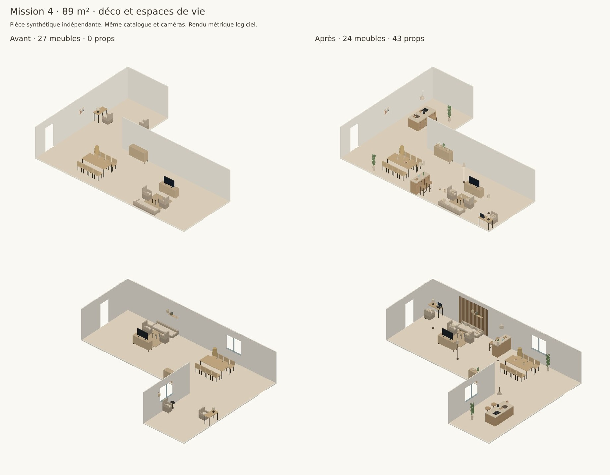
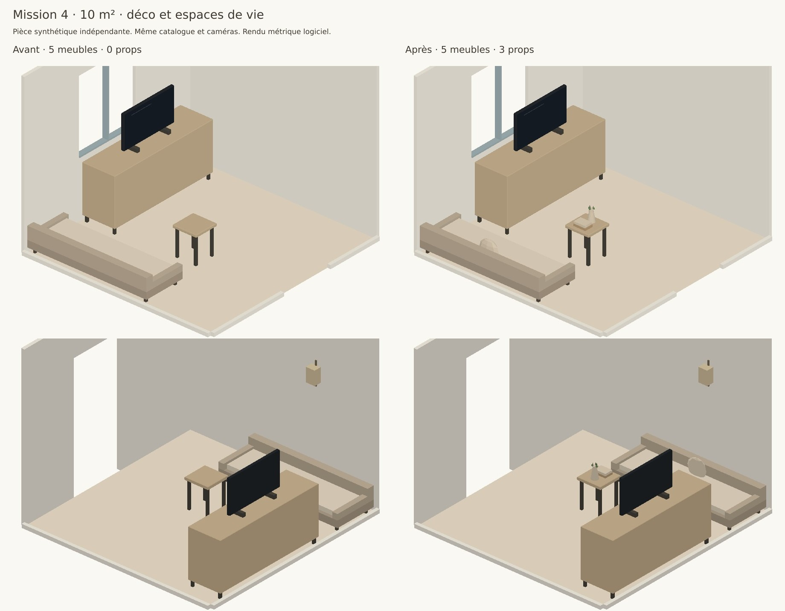

# Mission 4 — déco, végétal et espaces de vie

La nouvelle proposition ajoute une couche de mise en scène distincte du mobilier : accessoires attachés, plantes, murs à lattes ou panneaux, îlot et bar. Un conflit reproductible entre lampe de table et télévision est corrigé : la lampe réserve désormais le volume de l’écran, et la finition retire un accessoire avant la TV. Si aucun écran du catalogue de projet n’est retenu, un écran de mise en scène peut compléter son support ; il n’est jamais présenté comme une offre de la boutique.

Sur le séjour **synthétique de 89 m²**, cinq activités sont présentes : salon TV, repas, cuisine, bar, bureau. Chaque activité a un attrait, une lumière et un angle traité. Les tests automatisés et la comparaison visuelle sont archivés. Les chiffres concernent ces fixtures indépendantes, pas une mesure du logement du client.

## 1. Modèle et bibliothèque non vendue

`lib/staging-catalogue.js` contient **31 primitives originales**, leurs dimensions, descriptions et tags de style ; `moteur/staging.js` construit leurs volumes Three.js. Aucun asset externe ou licence commerciale ajoutée. Les tests contrôlent les dimensions effectives de chaque volume.

Les props résident dans `proposition.staging.items`, avec `origine: 'mise-en-scene'`, `vendu: false`, sans SKU, prix ni lien d’achat. Ils ne sont pas ajoutés à `agencement`, au catalogue marchand, au panier ou au total du mobilier. Les îlots, comptoirs et tabourets de référence participent cependant au solveur comme obstacles, puis sont séparés du mobilier avant sauvegarde. Le budget est sélectionné avant cette étape.

Un accessoire posé porte `kind: 'surface_item'`, `attach_to: {type: 'furniture', id}`, `local: [x, y, z]` et les dimensions de référence de son hôte. `posesStaging` recalcule sa pose après translation, rotation ou échange du support. Un objet dépassant un support devenu trop petit est masqué ; retirer le support retire ses accessoires. Les étagères murales suivent leur hauteur de fixation. Les lampes suspendues de cuisine/bar restent attachées à leur comptoir.

RealRoom et Maison Corleone utilisent le même rendu et la même sauvegarde. Les props ne sont pas des cartes de produits ni des objets sélectionnables dans l’éditeur. Corriger le contour ou les ouvertures invalide cette couche : un nouveau réaménagement la recalcule. Les contrôles d’acceptation portent sur la proposition produite ; une modification manuelle ultérieure ne constitue pas une nouvelle certification d’accès.

Les descriptions sont disponibles dans la bibliothèque et les objets apparaissent dans la capture 3D utilisée par le rendu existant. Le module de génération d’images du produit, ses fournisseurs et ses crédits restent inchangés.

## 2. Recettes par pièce et style

Les **84 combinaisons** (7 fonctions × 11 styles et un profil neutre) sont détaillées dans [recettes.json](staging/recettes.json), avec les hôtes, recettes, maxima et esprit. Les choix sont également consignés dans [DECISIONS.md](../DECISIONS.md).

| Hôte | Recette, sous réserve de place et de lumière |
|---|---|
| Table basse, appoint, chevet | Plateau, livres, vase, bougie ; petit salon : livres et vase |
| Console, buffet, vaisselier | Vase haut, livres, plante moyenne, petit objet sculptural |
| Étagère | Livres debout et sculpture/vase par niveau ; un niveau pour l’étagère murale |
| Bureau | Ordinateur, carnet, petite plante ; lampe du programme mobilier |
| Table de repas | Coupe de fruits et petit vase, sans gêner les places |
| Canapé, fauteuil, lit | Coussins, plaid hors épuré ; petite pièce : un coussin |
| Îlot | Planche, bouilloire, coupe ; réservation de l’évier et de la plaque |
| Bar | Plateau, bouteilles, verres |
| Vasque | Serviettes et bougie |

Le plafond est de deux props par surface en épuré, quatre en chaleureux/bohème/audacieux, trois dans les autres profils. Une surface de 14 m² ou moins utilise le plafond de deux et reçoit peu de textiles ; aucun grand prop ou feature wall automatique. Sur une étagère, le plafond s’applique à chaque niveau, conformément à la recette par niveau. Les objets trop grands ou en conflit avec une lampe/TV sont écartés.

Les variantes gardent des volumes sobres et une palette cohérente : bois/céramique/feuillage en chaleureux, céramique et végétal en bohème, palettes bois-or/vert en classique et Art déco, plus sombres en industriel. Les plantes demandent une fenêtre/baie à moins de 3,5 m : ce repère éditorial ne prédit pas les besoins botaniques ni la lumière réelle du logement.

## 3. Cuisine, bar et arbitrage

Sans choix explicites, un salon de plus de 40 m² reçoit une tentative de cuisine ; le bar s’ajoute à partir de 60 m². À plus de 75 m², le bureau est conservé et la lecture automatique cède la place aux deux nouvelles activités. Un brief ou des cases explicites peuvent demander/refuser ces espaces, y compris tenter une cuisine dans une surface plus petite. Aucun ajout impossible n’est forcé : le manque d’espace est déclaré.

L’ordre par défaut est **TV > cuisine > bar > bureau > lecture** ; le repas garde son programme et les choix du client restent prioritaires. Cuisine et bar sont injectés avant le placement macro : les placer seulement après les meubles pouvait conserver le bureau mais perdre la cuisine, ou négliger son accès. Le repli de placement reste borné à 24 états diversifiés. Le solveur réserve 1 m côté préparation de l’îlot, 75 cm derrière les tabourets et les chemins de 1,10 m du grand open-space.

L’îlot possède un évier et une plaque stylisés ; ce sont des volumes de présentation, sans proposition de raccordement ni déplacement d’une installation existante. Le bar reçoit deux tabourets de référence, des objets et sa suspension. Les luminaires de staging complètent aussi les sources nocturnes disponibles dans l’éditeur.

| Zone à 89 m² | Emprise englobante obtenue | Référence éditoriale du moteur |
|---|---:|---:|
| Salon TV | 9,81 m² | 20 m² |
| Repas | 6,94 m² | 16 m² |
| Cuisine | 5,33 m² | 12 m² |
| Bar | 2,57 m² | 8 m² |
| Bureau | 2,82 m² | 10 m² |
| Rangement, hors compte des activités | 0,61 m² | 8 m² |

Ces surfaces sont les rectangles englobant les objets de chaque zone, après traitement des angles. Elles ne représentent pas la surface totale de circulation ou une enveloppe réglementaire d’usage ; les dégagements et chemins sont vérifiés séparément. Les références ne sont pas des réservations fixes.

## 4. Feature walls et score

Les lattes, lambris et feuillages sont des `wall_item` fixés à un segment, avec hauteur et offset. Le placement utilise les intervalles de mur libres, soustrait toutes les portes/fenêtres et ajoute une marge. Maximum : un mur travaillé par zone, deux par pièce. Les lattes/panneaux sont fins pour ne pas masquer le tableau existant. Le feuillage est réservé au repas bohème près d’une fenêtre, jamais dans la zone TV.

| Règle | Poids |
|---|---:|
| Zone avec un hôte portant au moins deux props | +4 |
| Table basse vide | −5 |
| Surface portant plus de quatre props | −6 |
| Hauteurs monotones | −2 |
| Point focal masqué | −15 |
| Angle sans plante haute/lampadaire | −3 |
| Plante loin d’une ouverture lumineuse | −2 |
| Feature wall dans la zone | +5 |
| Lattes réellement derrière canapé/table | +3 |
| Végétal derrière la TV | −10 |
| Plusieurs feature walls dans une zone | −10 |
| Mur décoratif sur porte/fenêtre | −100 |
| Mur cohérent avec le style | +2 |

Le score et l’audit sont séparés : une belle note ne rend pas une collision admissible. Les objets au sol passent l’audit du plan, les objets posés les limites du support, et les murs les limites/ouvertures. Le score de 89 m² est **28** ; une pénalité de −2 subsiste sur les trois coussins de même hauteur, tandis que les compositions des plateaux ont des hauteurs variées. Il n’y a aucun angle nu, surcharge, plante sombre ou point focal masqué dans cette fixture.

## 5. Acceptation et régressions

**208/208 tests unitaires, 17/17 scénarios API et build de production réussis.** Les 198 tests précédents restent dans la série. Le nouveau cas API sauvegarde/recharge le séjour, contrôle les attaches après déplacement et le repli ; les cas précédents couvrent chambre, Mission 2/3, repas demandé, quotas, budget, détails muraux et parcours de rendu. API sur serveur local, PGlite isolé et fournisseurs simulés : aucun accès à la base de production.

| Surface | Mobilier avant → après | Props après | Activités avant → après | Murs après | Maximum par surface | Mobilier estimé avant → après |
|---|---:|---:|---:|---:|---:|---:|
| 10 m², minimaliste | 5 → 5 | 3 | 1 → 1 | 0 | 2 | 2 119 € → 2 119 € |
| 18 m² | 7 → 7 | 11 | 1 → 1 | 1 | 3 | 2 494 € → 2 494 € |
| 30 m² | 18 → 18 | 23 | 3 → 3 | 2 | 4 | 6 739 € → 6 739 € |
| 89 m² | 27 → 24 | 43 | 4 → 5 | 1 | 4 | 8 409 € → 7 894 € |

Les quatre cas gardent une TV, aucun manque obligatoire, un audit de staging vide et un plan admissible. Les chemins sont à 90 cm sur 10/18/30 et 1,10 m sur 89. Les props valent zéro dans le calcul. À 89 m², le prix baisse parce que le mobilier du coin lecture automatique disparaît au profit de cuisine/bar ; **ce n’est pas une comparaison à mobilier identique**. Un test séparé ajoute le staging à composition égale et vérifie l’absence de mutation du mobilier, de ses prix et du total.

Les 43 éléments de staging de 89 m² comprennent 11 objets au sol (architecture, sièges et angles), 29 objets posés/textiles, deux suspensions et un mur. Le compteur de densité utile exclut cette couche : des petits objets ne peuvent pas masquer un manque de mobilier.

Archives : [résultats JSON](staging/resultats.json), [unitaires](staging/unitaires.txt), [API](staging/api.txt), [build](staging/build.txt), [séquence](staging/sequence.txt), [rendus](staging/rendus.txt).

Le contrôle automatique a refusé la publication GitHub d’un instantané complet de pièce, jugé potentiellement privé. Aucun de ces JSON détaillés n’est publié : ils restent locaux dans `.data/staging-modeles`. Les scripts les régénèrent uniquement à partir des fixtures synthétiques du dépôt. Les bilans, les logs, le code des fixtures et les rendus sont les éléments de preuve publiés.

## 6. Preuve visuelle et critique





L’avant utilise le moteur du parent `cc158b5205f95dde0267de0721e61984236d9874`, avec le même catalogue commercial, la même fixture et les mêmes deux caméras. Il avait déjà quatre activités et une TV : aucune baseline artificiellement vide. La normalisation du tapis est commune aux deux rendus pour comparer le staging. Les contours en L sont respectés. Ces images sont des **maquettes logicielles métriques**, avec mobilier commercial simplifié et les mêmes constructeurs de props que l’éditeur ; ce ne sont pas des photos IA ou des captures WebGL du logement.

Trois critiques bornées via `openrouter/router/vision`, modèle `google/gemini-3.8-flash`, préfèrent après : **89 m² dans les deux ordres d’images**, puis 10 m² avec `B_surcharge: false`. Les réserves sur la densité autour des comptoirs et l’impossibilité de vérifier les mesures visuellement sont conservées ; aucun poids d’accès n’a été diminué pour gagner le classement. Les audits métriques restent indépendants de cet avis.

[Sorties intégrales nettoyées et empreintes](staging/vision.json), [protocole](staging/protocole-vision.json), [vérification locale des archives](staging/vision-verification.txt). Images incorporées, `store_payload: false`, aucun téléversement CDN ou fichier client. Les textes des deux questions 89 m² sont archivés ; la question exacte 10 m² ne l’a pas été et sa reconstruction pour rejeu est signalée. L’avis original 10 m² et ses images sont conservés intégralement.

Le contrôle interactif navigateur n’a pas pu être exécuté : Chromium local n’a pas pu être installé, et le navigateur cloud disponible atteignait la connexion Vercel. Le build, l’API, la géométrie, les volumes et les maquettes sont contrôlés ; un parcours interactif WebGL complet n’est pas revendiqué.

## 7. Catalogue : offres et trous à décider

Le catalogue garde **341 produits commerciaux et 54 références de projet**. Les génériques précédemment autorisés gardent leur provision de budget indicative et leur absence de lien marchand ; cette mission ne transforme pas rétroactivement un meuble générique en prop gratuit.

| Usage | État dans les données actuelles | Décision |
|---|---|---|
| Télévision | Aucune offre commerciale identifiée ; TV génériques de projet existantes | Conserver les références de projet ; repli non vendu si l’écran manque, note explicite dans le plan de vie |
| Cuisine / îlot / électroménager | Aucune famille commerciale adaptée identifiée | Mise en scène architecturale, sans prix/offre ou raccordement inventé |
| Bar / comptoir | Aucun comptoir commercial identifié | Mise en scène architecturale |
| Tabourets hauts | Fleur de Nuit (0,45 × 0,45 × 0,78 m, 1 181,25 €) et Diamond (0,45 × 0,50 × 1,10 m, 1 687,50 €) existent | Hauteur d’assise inconnue : ne pas prétendre leur compatibilité avec les deux comptoirs ; garder les tabourets de référence en props |
| Tabouret enfant | Square Kid, hauteur totale 0,40 m | Ne pas l’utiliser comme siège adulte de bar |
| Ordinateur, accessoires, plantes, murs travaillés | Pas d’offre marchande ajoutée par cette mission | Bibliothèque non vendue ; conserver les objets de projet préexistants distinctement |
| Tapis `al-480` | Dimensions source `[1,5 ; 0,05 ; 1,9]` | Réordonner en largeur/profondeur/hauteur `[1,5 ; 1,9 ; 0,05]`, sans modifier les données sources ou inventer une cote ; rendu désormais au sol |

[Inventaire reproductible](staging/inventaire.json). Les absences décrivent les données du dépôt, pas l’ensemble du stock de la boutique.

## 8. Preview, drapeau et reproduction

[Maison Corleone — preview de la branche](https://realroom-git-codex-realroom-plan-optimisation-2026-10-09-kpw4.vercel.app/fr/maison-corleone/demo) · [PR nº 2](https://github.com/CelKevProductions/realroom/pull/2).

**Publication Mission 4 en attente d’autorisation explicite.** Le contrôle automatique a également refusé la nouvelle version de `DECISIONS.md`, considérée comme une divulgation technique vers un dépôt public non explicitement approuvé. La version précédente a été vérifiée publique et identique au parent local, sans nouvelle valeur secrète détectée ; le refus persiste. Aucun contournement, mise à jour de branche distante ou déploiement Mission 4 n’a été effectué. L’URL ci-dessus dessert donc encore la version précédente ; les changements et preuves Mission 4 sont préparés localement.

La couche est activée par défaut pour les nouvelles propositions de réaménagement complet guidé, avec composition de surface et finition activées. Après le déploiement, recharger la page puis **Réaménager toute la pièce** : le déploiement ne réécrit pas une proposition enregistrée. Cuisine et bar apparaissent dans le dialogue d’idées/espaces partagé.

Repli serveur : `REALROOM_STAGING=0`. Repli au build navigateur : `NEXT_PUBLIC_REALROOM_STAGING=0`. Essai immédiat : `localStorage.setItem('rr-staging','0')`, recharger, puis refaire une proposition. Supprimer la clé réactive la couche. Les API acceptent aussi `staging: false`. Ce drapeau concerne les nouvelles propositions ; il n’efface pas automatiquement le staging d’une pièce sauvegardée. Les anciens drapeaux de composition restent indépendants.

Reproduction depuis le dépôt :

```sh
npm ci
npm test
npm run build
env -u DXF_REGRESSION PORT=3281 node tests/api.mjs
node scripts/inventorier-staging.mjs
mkdir -p /tmp/realroom-staging-baseline
git archive cc158b5205f95dde0267de0721e61984236d9874 lib data | tar -x -C /tmp/realroom-staging-baseline
BASELINE_STAGING=/tmp/realroom-staging-baseline node scripts/valider-staging.mjs
node scripts/illustrer-staging.mjs
node scripts/critiquer-staging.mjs
```

Le script de séquence garde les modèles complets dans `.data/staging-modeles` (ou `STAGING_MODELES`), puis le script de rendu les lit localement. Le dernier script vérifie les empreintes et les classements archivés sans appel externe. Un rejeu vision avec `--executer --cas=89-direct` et `FAL_KEY` est facturable et limité à un appel par cas, sans reprise automatique ; les futurs résultats peuvent varier. Les archives originales ne sont pas écrasées.

Même branche dédiée, aucune fusion, promotion ou modification de base en production. Aucun plan DXF, image ou donnée privée du client publié. La publication proposée concerne le code, la documentation, les bilans et les rendus synthétiques ; les instantanés complets de pièces restent exclus.
