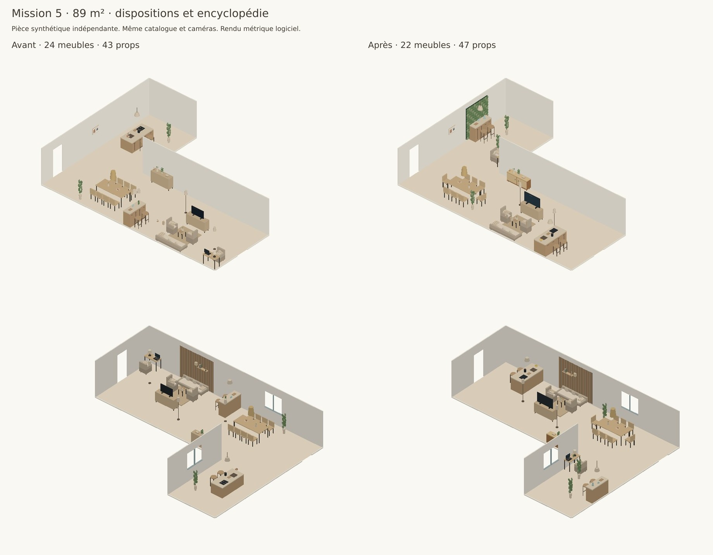

# Mission 5 — encyclopédies et modèles 3D

L’intégration expérimentale des deux tomes est prête localement, avec les données, les graines métier, les variantes, les règles et huit prototypes non vendus. La version finale du séjour synthétique de 89 m² gagne les deux comparaisons visuelles, dans les deux ordres. La publication publique et la création de la preview ont été explicitement autorisées le 12 octobre. Elles sont en cours ; aucun merge ni changement de production n’a été fait.

## Données et périmètre réellement actif

| Collection | Nombre |
|---|---:|
| Zones | 100 |
| Dispositions source | 521 |
| Meubles et références nommées | 242 |
| Props B/S | 155 |
| Règles | 81 |
| Signature moments | 55 |

Les 702 lignes du tome 1 et les 928 du tome 2 sont couvertes. Les tables, paragraphes, conditions, avantages, limites et sources restent dans [base.json](../data/encyclopedie/base.json), avec les empreintes des deux documents. [runtime.json](../data/encyclopedie/runtime.json) alimente le moteur ; [la documentation](../data/encyclopedie/README.md) décrit les champs et la reproduction.

Les IDs restent ceux de l’encyclopédie. `CH-1.01` reste `CH-1.01` ; son UID est `CH:CH-1.01`. Les renvois entre salon, repas et cuisine sont reliés. La cohérence des références est testée. Les trous restent visibles : neuf zones sans disposition, six dispositions sans meuble explicite, 204 triplets de dimensions incomplets. Aucune cote marchande n’est fabriquée pour les combler.

**Couverture des données et exécution sont différentes.** Le [manifeste](../data/encyclopedie/dispositions-operations.json) contient les 521 lignes : 34 interpréteurs sont actifs ; 107 lignes demandent des préconditions ou un modèle spécifique ; 380 autres restent sans interpréteur ou modèle compatible. Les formes particulières, mécanismes ouverts, installations non relevées et zones rares restent à traiter. Elles ne sont pas présentées comme fonctionnelles sous un faux ID.

## Composition, graines et variantes

Les paliers de surface existants restent l’arbitre. Les zones reçoivent les minima et conditions des tomes ; un coin café ou une bibliothèque demandé dans le brief utilise la zone source correspondante. Les prototypes ne deviennent pas des achats. Le bureau est réservé tôt pour ne pas perdre les emplacements compatibles avec les fenêtres lorsque les îlots et le bar sont ajoutés.

Les graines sont construites à partir des dimensions des objets réellement retenus, filtrées géométriquement, puis affinées par le recuit. Les IDs source restent enregistrés, y compris après un PATCH des positions. Le bouton de comparaison de l’expérimentation propose jusqu’à trois placements distincts, avec les mêmes produits et les accès contrôlés. Le contrôle du navigateur WebGL et des clics reste à faire ; la génération des variantes, leur validation et la sauvegarde HTTP sont testées.

Extrait des logs de référence :

```text
Chambre 16 m² : couchage CH-1.03 ; rangement CH-3.04
Séjour 89 m² : salon 1.5 ; travail BU-1.01 ; repas SAM-1.01
               cuisine CU-2.01 ; bar 3.1 ; rangement SAM-2.01
Recuit : grainesSource conservées ; audit de placement valide
```

L’îlot CU-2.01 utilise le type de géométrie de travail du tome, adapté à l’enveloppe du prototype existant de 2 × 0,95 m. La cote 100 × 60 citée dans cette ligne est l’exemple compact de la source, pas la dimension d’un produit marchand ajouté. Cette mise en scène ne valide aucune plomberie.

| Pièce | Lignes source | Contextes générés |
|---|---:|---:|
| Salon | 257 | 257 |
| Chambre | 119 | 256 |
| Salle à manger | 29 | 256 |
| Cuisine | 30 | 256 |
| Bureau | 23 | 230 |
| Salle de bain | 21 | 210 |
| Entrée | 10 | 100 |
| Balcon | 10 | 100 |
| Annexes | 22 | 220 |

Le texte annonce 128 dispositions de chambre, mais les tableaux en contiennent 119. Le générateur répartit les variations sur toutes ces lignes et croise profils et orientations de fenêtre. Les 256 contextes ont des identifiants uniques ; ils ne constituent pas 256 nouvelles géométries originales. Les équivalences géométriques sont éliminées avant placement. [Détail des variantes](encyclopedie/variantes.json) et [comptes par zone](encyclopedie/acceptation.json).

## Règles, refus et recettes

Les contrôles PMR, le couchage haut et le garde-corps sont bloquants dans leur contexte. Les tests couvrent les réussites et les échecs : cercle de 150 cm, passages de lit 90/120 ou 120/90, dégagement cuisine 150 cm, ouverture et circulation, hauteur libre sous vasque, âge et barrières du couchage haut, validation fournisseur manquante, hauteur et voisinage du garde-corps. Un plan refusé renvoie 422 avant sauvegarde, en réaménagement complet ou partiel ; la pièce précédente est conservée.

Les recommandations INRS ne deviennent pas une loi de distance œil-écran. Le mode ergonomie stricte impose 50–70 cm comme politique de conception et refuse une mesure absente. La hauteur de couchage 40–50 cm est une cible de confort dans le contexte logement, pas une obligation générale tirée de l’article 13 de l’arrêté de 2015. La logique de contrôle NF EN 747 est testée avec des métadonnées fictives : elle ne certifie pas la résistance mécanique d’un modèle fabriqué. Les audits gardent `certification: false`.

Les divergences et sources primaires sont documentées dans [DECISIONS.md](../DECISIONS.md). Les valeurs remplacées dans l’expérimentation comprennent les proportions d’œuvre, la suspension de repas à 80 cm, celle de l’îlot à 90 cm et l’écart plateau-assise de 25–30 cm. Le score rend les mesures et leurs écarts ; les règles inapplicables ou privées d’une donnée restent explicitement non mesurées. Une hauteur totale de fauteuil ne devient jamais une hauteur d’assise.

Les recettes relient les props aux tomes et gardent la séparation B/S. Les nouveaux objets sont tous S. Dans le séjour de référence, trois nouveaux modèles sont effectivement utilisés : enfilade, carafe et citrons. Deux signatures sont réalisées : plateau d’îlot aux angles arrondis, et mur végétal stabilisé au bar sur un pan libre d’au moins 150 cm, hors télévision et ouverture. Le mur végétal réutilise un modèle existant ; aucun neuvième modèle n’est produit.

## Huit modèles et contrôle utilisateur

Plafond retenu : huit modèles, dont quatre meubles principaux, deux meubles de bar et deux accessoires. La [liste priorisée](encyclopedie/manques.json) analyse 366 références : 73 en priorité 1, 127 en priorité 2, 166 en priorité 3. Elle distingue 104 manques, 132 compatibilités à confirmer, six meubles produits comme prototypes et 124 recettes à résoudre. Une compatibilité proposée par le nom ou la famille n’est pas une validation de produit.

| Modèle | L × P × H (mm) | Contrôle sous trois angles |
|---|---|---|
| Console derrière canapé | 1200 × 300 × 700 | [Rendus](encyclopedie/modeles/enc-console-dos-controle.jpg) |
| Console TV suspendue | 1200 × 300 × 250 | [Rendus](encyclopedie/modeles/enc-console-tv-suspendue-controle.jpg) |
| Bar cart | 600 × 400 × 800 | [Rendus](encyclopedie/modeles/enc-bar-cart-controle.jpg) |
| Armoire-bar | 900 × 450 × 1400 | [Rendus](encyclopedie/modeles/enc-armoire-bar-controle.jpg) |
| Enfilade | 1600 × 400 × 750 | [Rendus](encyclopedie/modeles/enc-enfilade-controle.jpg) |
| Bibliothèque ouverte | 800 × 300 × 1800 | [Rendus](encyclopedie/modeles/enc-bibliotheque-ouverte-controle.jpg) |
| Carafe | 130 × 130 × 260 | [Rendus](encyclopedie/modeles/enc-carafe-controle.jpg) |
| Bol de citrons | 240 × 240 × 120 | [Rendus](encyclopedie/modeles/enc-bol-citrons-controle.jpg) |

Les fiches complètes, matériaux, emprises, surfaces et dégagements sont accessibles dans [l’index des modèles](encyclopedie/modeles/README.md). Les six meubles utilisent des triplets complets de la source. La carafe est une hypothèse éditoriale explicitement marquée ; le bol reprend l’enveloppe existante. Aucun SKU, prix ni offre marchande n’est créé.

Les 96 configurations — huit modèles × douze jeux de matériaux — passent le [contrôle des bounding boxes](encyclopedie/modeles/controles.json) à ±5 %. Un objet déformé de 6 % est rejeté dans les tests. Les trois angles sont enregistrés pour ta vérification ; ils n’ont pas été validés visuellement par l’assistant pendant la mission. Tous les modèles gardent `classe: S`, `vendu: false` et `validationProduit: false`.

Génération 3D : **0 appel API, 0 USD**, modélisation procédurale dans la pipeline Three.js existante. Les manques rares et les validations commerciales attendent une décision.

## Validation et avant/après

**230 tests unitaires passent**, dont les 208 précédents, 20 tests d’intégration de la mission et deux contrôles d’activation ajoutés pour la publication. **19 scénarios d’API passent**, avec fournisseur simulé et base locale isolée. Le build Next.js passe. Les flux de génération d’images et de visites existants restent dans les tests d’API ; leur module original n’est pas modifié.

Les résultats des références chambre et salons 10/18/30/89 m² sont dans [acceptation.json](encyclopedie/acceptation.json). Les placements et le staging sont validés ; aucune activité obligatoire ne manque dans ces références. Le séjour garde cinq activités, plus un rangement complémentaire, et ses passages de 110 cm.

| Référence 89 m² | Mission 4 | Mission 5 |
|---|---:|---:|
| Meubles catalogue | 24 | 22 |
| Props de mise en scène | 43 | 47 |
| Activités | 5 | 5 |
| Télévision visible | Oui | Oui |
| Coût catalogue de la fixture | 7 894 € | 6 954 € |
| Coût des props | 0 € | 0 € |

Les compositions ne sont pas identiques : la télévision générique et le buffet catalogue sont remplacés par des objets S. Le total est celui du jeu de données de test, pas une nouvelle offre commerciale.



[Avant](encyclopedie/89-avant.jpg) · [Après](encyclopedie/89-apres.jpg). Même fixture, mêmes caméras ; rendu logiciel simplifié, sans photo client ni certification visuelle des mesures.

Le dernier classement préfère la mission 5 **dans les deux ordres** : B quand elle vient en second, A quand elle vient en premier. La télévision est reconnue dans les deux versions. Le modèle conserve des réserves sur l’îlot, la sensation d’encombrement et les passages ; ces réserves restent dans [vision.json](encyclopedie/vision.json), à côté des contrôles géométriques.

Trois itérations précédentes préféraient la mission 4. Elles sont archivées, sans masquer leurs échecs. Le protocole final garde le modèle et le prompt de la mission 4, avec les empreintes exactes des images. Deux résultats finaux favorables ne garantissent pas une préférence universelle. Huit appels de vision ont coûté **0,0338985 USD** selon les usages retournés, séparément du coût 3D nul. [Protocole](encyclopedie/protocole-vision.json).

Les [logs](encyclopedie/logs/README.md) couvrent tests unitaires, API, build, parsing, contrôle de dimensions et critique. La vérification des archives vision est reproductible sans dépense ; `--executer` soumet un nouvel appel facturable.

## Branche et preview

Branche dédiée : `codex/realroom-mission5-encyclopedie-2026-10-12`, issue du commit local de mission 4 `ad99c68`. La publication est autorisée ; aucun merge ni changement de base en production.

L’expérimentation est désactivée par défaut. Le build active `REALROOM_ENCYCLOPEDIE=1` et `NEXT_PUBLIC_REALROOM_ENCYCLOPEDIE=1` uniquement pour l’environnement preview et cette branche exacte. La connexion Vercel refuse l’écriture des variables (403), sans CLI authentifiée disponible ; cette activation est donc portée par la configuration de build. Un choix `false` ou une variable à `0` la désactive. La [documentation d’activation](../data/encyclopedie/README.md) donne aussi l’essai local.

Il n’y a **pas encore d’URL de nouvelle preview de mission 5**. [La preview de la branche antérieure](https://realroom-git-codex-realroom-plan-optimisation-2026-10-09-kpw4.vercel.app/fr/maison-corleone/demo) n’est pas le livrable de cette mission. Le propriétaire a explicitement autorisé la publication du code, des données issues des tomes, du rapport et des rendus dans le dépôt public `CelKevProductions/realroom` pour déclencher cette nouvelle preview. Le contrôle automatique maintient le refus de publier la nouvelle version de `DECISIONS.md`, non nommée explicitement dans cette autorisation. Ce document reste local : le dépôt conserve sa version publique antérieure. La publication du code, des données, du rapport et des rendus se poursuit sans ce document.
