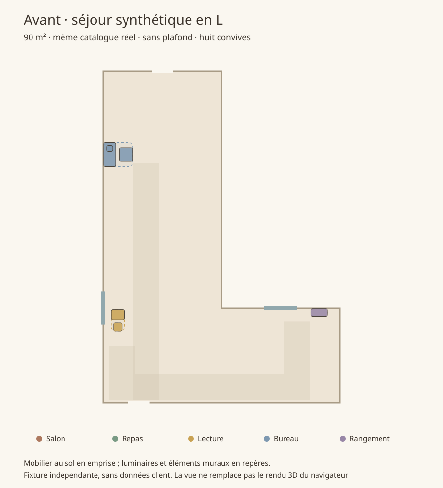
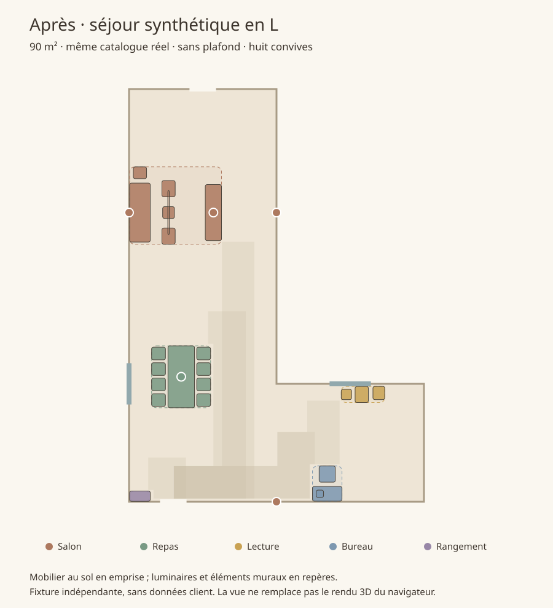

# Coin repas absent malgré un catalogue compatible

La capture signalait un coin repas absent et un éclairage de lecture rejeté pour « budget insuffisant ». Le parcours de sélection reproduit ces deux erreurs, même sans plafond de budget. Les tests précédents de surface ne couvraient pas le brief vide ou limité à une palette avec le sous-catalogue réel de dix candidats par famille.

## Corrections

- La sélection réserve des produits correspondant aux usages et au nombre de convives **avant** la diversité des couleurs. Une table compacte pour quatre ne couvre plus le besoin de huit places. Le brief, le vrai contour, les exclusions et les flags sont transmis dans la démo IA, l’API avec compte et la simulation.
- Un même modèle de lampadaire peut être acheté deux fois pour éclairer deux activités. La quantité réelle compte dans le budget. Le modèle IA reçoit la même règle.
- Si aucun salon compact ne peut être posé, une variante place le lampadaire à côté du canapé. L’ancien patron pouvait le placer dans les 80 cm d’accès du meuble TV et rendre tout le groupe impossible. Les patrons déjà fonctionnels sont conservés.
- Entre deux solutions accessibles, la reprise privilégie la présence de l’activité principale avant le nombre d’activités secondaires complètes.
- Un retrait à la sélection ou sans plafond n’est plus automatiquement décrit comme un manque de budget. Les manques restent visibles et les vrais plafonds restent contraignants.

## Reproduction avec le catalogue partagé

La fixture est un séjour **synthétique** en L de 90 m², avec deux portes et deux fenêtres. Elle ne reprend aucun plan client. Même contour, catalogue, brief vide, huit convives et absence de plafond avant/après. Le commit comparé est `c6fb84e39466e826e985a40d2edb731eecdf27a0`.

| Scénario | Objets avant → après | Table avant → après | Chaises avant → après | Activités avant → après | Manques obligatoires après |
|---|---:|---:|---:|---:|---:|
| Brief vide, choix des quatre espaces | 17 → 27 | 0 → 1 | 0 → 8 | 3 → 4 | 0 |
| Deux lampadaires identiques proposés | 6 → 28 | 0 → 1 | 0 → 8 | 2 → 4 | 0 |

Le second scénario conserve maintenant deux exemplaires du lampadaire. Les deux résultats corrigés passent les contrôles du sol, des hauteurs, des accès et des chemins de 1,10 m. Le contour et les ouvertures restent identiques. L’ancien audit géométrique pouvait être valide malgré l’absence d’une activité : le programme et ses manques sont vérifiés séparément, sans assimiler une pièce vide à une composition complète.

Le second cas corrigé ne manque aucun slot, même facultatif. Son diagnostic de densité ne le marque plus « à compléter » ; deux pans restent classés comme murs libres. Ce résultat est limité à la fixture et ne certifie ni l’échelle terrain ni l’esthétique de toute pièce.





Ces figures sont des vues métriques en plan, pas des captures WebGL ni des images générées. Le modèle exact du navigateur du client n’est pas disponible dans cette session ; les cas sont des reproductions indépendantes des défauts visibles. Aucun test interactif navigateur n’est revendiqué pour cette correction. Le module de génération d’images reste inchangé.

## Validation et reproduction

**198 tests unitaires réussis, 16 scénarios API réussis et compilation réussie.** Les scénarios API de 90 m² et en L vérifient explicitement la présence de la table, huit chaises, le programme obligatoire et la sauvegarde/relecture. Base locale et fournisseur simulé. Les nouveaux tests couvrent aussi les palettes, la répétition des luminaires sous un budget exact et les espaces décochés.

Les [résultats](repas-catalogue/resultats.json), [séquence](repas-catalogue/sequence.txt), [tests unitaires](repas-catalogue/unitaires.txt), [API](repas-catalogue/api.txt) et [compilation](repas-catalogue/build.txt) sont archivés.

```sh
export BASELINE_REPAS="$(mktemp -d /tmp/realroom-repas-baseline.XXXXXX)"
git archive c6fb84e39466e826e985a40d2edb731eecdf27a0 lib package.json | tar -x -C "$BASELINE_REPAS"
node scripts/valider-repas-catalogue.mjs
npm test
npm run build
env -u DXF_REGRESSION PORT=3267 node tests/api.mjs
```

Le flag de surface existant reste disponible : `REALROOM_COMPOSITION_SURFACE=0`, `NEXT_PUBLIC_REALROOM_COMPOSITION_SURFACE=0` ou `localStorage.setItem('rr-composition-surface', '0')`, puis rechargement. Il retire les nouvelles réservations liées au programme de surface et restaure ses paliers précédents.

[Prévisualisation Maison Corleone](https://realroom-git-codex-realroom-plan-optimisation-2026-10-09-kpw4.vercel.app/fr/maison-corleone/demo) · [PR nº 2](https://github.com/CelKevProductions/realroom/pull/2). Recharger, puis relancer « Réaménager automatiquement » avec le coin repas coché. Une disposition enregistrée n’est pas écrasée au seul rechargement.
